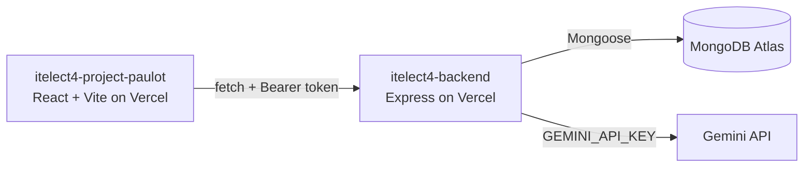

# CloudOps Portal — Backend API (ITELECT4 GT4)

[](https://github.com/papap7/itelect4-backend/actions/workflows/ci.yml)

RESTful API backend for the CloudOps Provisioning and Workspace Management Portal.

## 🔗 Live Deployments & Repositories

- **Live Backend API:** [https://itelect4-backend-sand.vercel.app](https://itelect4-backend-sand.vercel.app)
- **Live Frontend App:** [https://itelect4-project-paulot.vercel.app](https://itelect4-project-paulot.vercel.app)
- **Frontend GitHub Repo:** [https://github.com/papap7/itelect4-project-paulot](https://github.com/papap7/itelect4-project-paulot)
- **Backend GitHub Repo:** [https://github.com/papap7/itelect4-backend](https://github.com/papap7/itelect4-backend)

---

## 🏗️ Architecture



---

## 🛠️ Tech Stack

- **Runtime:** Node.js / Express
- **Language:** TypeScript (Strict mode)
- **Database:** MongoDB Atlas via Mongoose (Serverless connection promise-caching)
- **Authentication:** JWT (JSON Web Tokens) & bcryptjs password hashing
- **AI:** Google Gemini (`@google/genai`) with a Zod-checked reply
- **Testing:** Vitest + Supertest
- **CI:** GitHub Actions (type check and tests on every push)
- **Deployment:** Vercel Serverless Functions

---

## 📡 API Endpoints

### Public Routes
- `GET /api/health` — Service health & MongoDB connection status (`{"ok": true, "db": true}`)
- `GET /api/workspaces` — List of all 6 reference workspaces (sorted by `workspaceId`)
- `GET /api/workspaces/:workspaceId` — Fetch a single workspace by numeric ID
- `POST /api/auth/register` — Create new engineer account (`{ name, email, password }`)
- `POST /api/auth/login` — Authenticate and receive JWT token (`{ email, password }`)

### Protected Routes (Requires `Authorization: Bearer <token>`)
- `GET /api/provision-requests` — Fetch provision requests owned by the authenticated engineer
- `POST /api/provision-requests` — Create a new provision request (`{ workspaceId, resourceType }`)
- `GET /api/provision-requests/:id` — Fetch request details
- `PATCH /api/provision-requests/:id` — Update request
- `DELETE /api/provision-requests/:id` — Delete request
- `POST /api/ai` — Ask Gemini to review a resource description (`{ prompt }`, 20 to 2000 characters). Rate limited to 5 requests per minute per account

---

## 💻 Local Development

1. **Clone repository:**
   ```bash
   git clone https://github.com/papap7/itelect4-backend.git
   cd itelect4-backend
   ```
2. **Install dependencies:**
   ```bash
   npm install
   ```
3. **Environment Setup:**
   Create a `.env` file based on `.env.example`:
   ```env
   MONGODB_URI=your_mongodb_connection_string
   JWT_SECRET=your_jwt_secret
   GEMINI_API_KEY=your_gemini_api_key
   PORT=4000
   CORS_ORIGIN=http://localhost:5173
   ```
4. **Seed Database:**
   ```bash
   npm run seed
   ```
5. **Start Dev Server:**
   ```bash
   npm run dev
   ```
6. **Run the tests:**
   ```bash
   npm test
   ```
   The tests need no database and no Gemini key: `connectDB` is replaced with `vi.mock`, MongoDB's driver calls are answered from an in-memory array (`tests/helpers/fakeDb.ts`), and Gemini's client is mocked. They do need `JWT_SECRET`, which they read from `.env` on your laptop and from a GitHub Actions secret in CI.

---

## 🧪 Tests & CI

Supertest sends real requests to the real Express app (no port is opened). Only two things are replaced:

- **MongoDB's driver calls.** `tests/helpers/fakeDb.ts` answers `insertOne`, `find`, `findOne`, `updateOne`, `findOneAndUpdate` and `findOneAndDelete` from an in-memory array. Everything above that line is the real code: Mongoose casting, schema validation, the password-hashing hook, `toJSON`, the routes and the middleware.
- **Gemini's client.** No test spends API quota.

| File | What it checks |
| --- | --- |
| `cors-cache.test.ts` | Each frontend domain gets its own `Access-Control-Allow-Origin`; `Vary: Origin`; `Cache-Control: no-store` and no `ETag` on every response; the old-domain → new-domain → old-domain sequence that used to fail; `parseOrigins` |
| `workspace.test.ts` | Public list sorted 101–106, single workspace, 404, non-numeric id → 400, seed data valid |
| `auth.test.ts` | Register (201, hashed password, trimmed/lowercased email, role cannot be chosen, 409 duplicate, 400 validation) and login (token payload and 2 h expiry, case-insensitive email, the same 401 for wrong password and unknown email) |
| `provisionRequest.test.ts` | All five routes need a token; create/list/get/update/delete; each user sees only their own requests; someone else's request is a 404 |
| `ai.test.ts` | `POST /api/ai`: auth, prompt validation, the 429/502/500 mapping of Gemini errors, and the 5-per-minute-per-account rate limit |
| `gemini.test.ts` | `adviseRequest`: model, system prompt and schema sent; examples as earlier turns; 503 fallback model; unusable replies → `AiReplyError` |
| `schemas.test.ts` | Request and reply schemas at their boundaries; every worked example passes the reply schema |
| `requireAuth.test.ts` | Valid, missing, wrong-scheme, expired, wrong-secret, unsigned (`alg: none`) and edited tokens |
| `db.test.ts` | `connectDB`: missing URI message, one connection for concurrent callers, retry after a failed attempt |
| `app.test.ts` | Health check, the connect-before-every-route middleware, JSON 404s, headers on errors |
| `models.test.ts` | Password never in JSON or default queries, hash only on password change, enums and defaults |

`.github/workflows/ci.yml` runs `npm run typecheck` and `npm test` on every push, with `JWT_SECRET` from a repository secret. The badge at the top of this file shows the result of the latest run.
