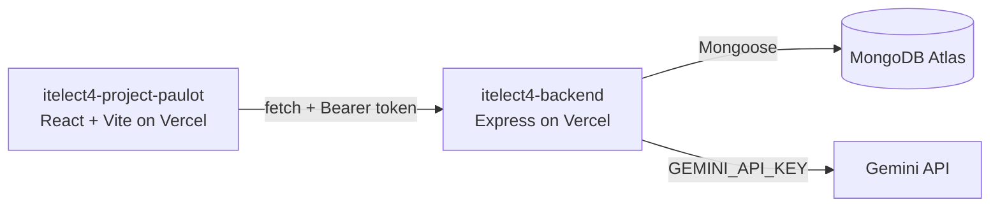

# CloudOps Portal — Backend API (ITELECT4 GT4)

[](https://github.com/papap7/itelect4-backend/actions/workflows/ci.yml)

RESTful API backend for the CloudOps Provisioning and Workspace Management Portal.

## 🔗 Live Deployments & Repositories

- **Live Backend API:** [https://itelect4-backend-sand.vercel.app](https://itelect4-backend-sand.vercel.app)
- **Live Frontend App:** [https://itelect4-project-paulot.vercel.app](https://itelect4-project-paulot.vercel.app)
- **Frontend GitHub Repo:** [https://github.com/papap7/itelect4-project-paulot](https://github.com/papap7/itelect4-project-paulot)
- **Backend GitHub Repo:** [https://github.com/papap7/itelect4-backend](https://github.com/papap7/itelect4-backend)

---

## 🏗️ Architecture



---

## 🛠️ Tech Stack

- **Runtime:** Node.js / Express
- **Language:** TypeScript (Strict mode)
- **Database:** MongoDB Atlas via Mongoose (Serverless connection promise-caching)
- **Authentication:** JWT (JSON Web Tokens) & bcryptjs password hashing
- **AI:** Google Gemini (`@google/genai`) with a Zod-checked reply
- **Testing:** Vitest + Supertest
- **CI:** GitHub Actions (type check and tests on every push)
- **Deployment:** Vercel Serverless Functions

---

## 📡 API Endpoints

### Public Routes
- `GET /api/health` — Service health & MongoDB connection status (`{"ok": true, "db": true}`)
- `GET /api/workspaces` — List of all 6 reference workspaces (sorted by `workspaceId`)
- `GET /api/workspaces/:workspaceId` — Fetch a single workspace by numeric ID
- `POST /api/auth/register` — Create new engineer account (`{ name, email, password }`)
- `POST /api/auth/login` — Authenticate and receive JWT token (`{ email, password }`)

### Protected Routes (Requires `Authorization: Bearer <token>`)
- `GET /api/provision-requests` — Fetch provision requests owned by the authenticated engineer
- `POST /api/provision-requests` — Create a new provision request (`{ workspaceId, resourceType }`)
- `GET /api/provision-requests/:id` — Fetch request details
- `PATCH /api/provision-requests/:id` — Update request
- `DELETE /api/provision-requests/:id` — Delete request
- `POST /api/ai` — Ask Gemini to review a resource description (`{ prompt }`, 20 to 2000 characters). Rate limited to 5 requests per minute per account

---

## 💻 Local Development

1. **Clone repository:**
   ```bash
   git clone https://github.com/papap7/itelect4-backend.git
   cd itelect4-backend
   ```
2. **Install dependencies:**
   ```bash
   npm install
   ```
3. **Environment Setup:**
   Create a `.env` file based on `.env.example`:
   ```env
   MONGODB_URI=your_mongodb_connection_string
   JWT_SECRET=your_jwt_secret
   GEMINI_API_KEY=your_gemini_api_key
   PORT=4000
   CORS_ORIGIN=http://localhost:5173
   ```
4. **Seed Database:**
   ```bash
   npm run seed
   ```
5. **Start Dev Server:**
   ```bash
   npm run dev
   ```
6. **Run the tests:**
   ```bash
   npm test
   ```
   The tests need no database and no Gemini call: `connectDB` is replaced with `vi.mock`, and the only request that carries a valid token is refused by the request schema before Gemini is reached. They do need `JWT_SECRET`, which they read from `.env` on your laptop and from a GitHub Actions secret in CI.

---

## 🧪 Tests & CI

`tests/ai.test.ts` uses Supertest to send real requests to the real Express app (no port is opened) and checks `POST /api/ai`:

- no token → `401`, "No token. Send Authorization: Bearer <token>"
- a token signed with another secret → `401`, "Token is invalid or has expired"
- a valid token with a too-short prompt → `400`, so it got past `requireAuth` without reaching Gemini

`.github/workflows/ci.yml` runs `npm run typecheck` and `npm test` on every push, with `JWT_SECRET` from a repository secret. The badge at the top of this file shows the result of the latest run.

---

## 🤖 AI Use Disclosure

<!-- TODO (author): list the AI tools you used, what for, and what you wrote or changed yourself. -->
_To be completed by the author._
